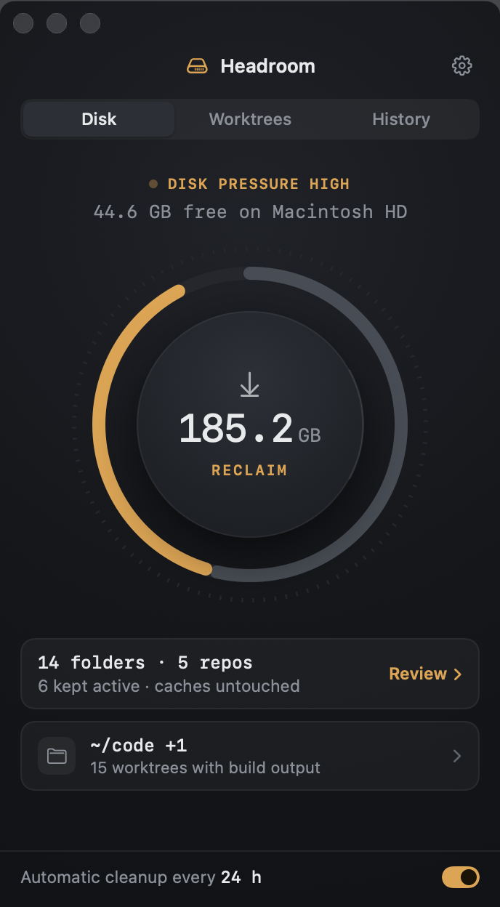
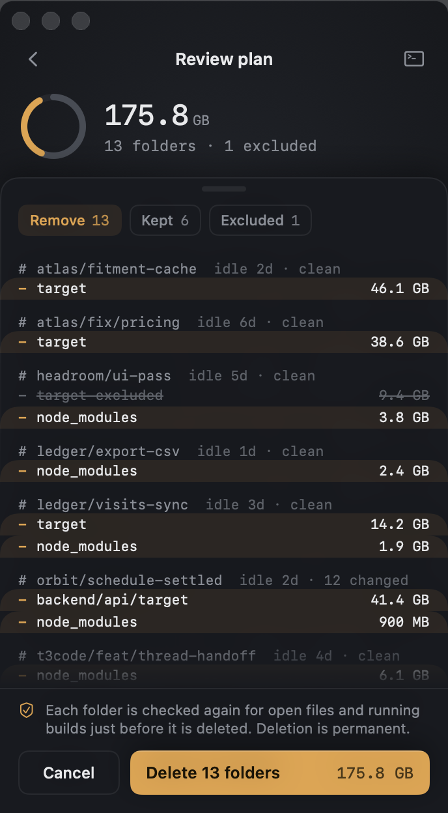
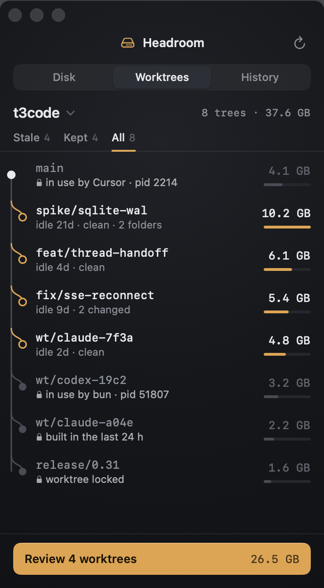

# Headroom

Headroom finds stale build output across your repositories and agent worktrees and gives the space back. It removes `node_modules` and Cargo `target` folders from worktrees nobody is using, and leaves source, branches, lockfiles, worktrees, and shared compiler and package caches alone.

It is a native Mac menu bar utility with one narrow window: a disk ring, one button, and a review of exactly what will be deleted.

<p align="center">
  
  
  
</p>

Downloads: [GitHub Releases](https://github.com/HelpsHelps2/Headroom/releases)

## Build from source

Requires Apple Silicon, macOS 26+, and the currently validated Xcode 27 / Swift 6.4 toolchain.

```sh
bash scripts/build-app.sh
open dist/Headroom.app
```

Headroom lives in the menu bar and opens its window at launch. Choose **Add folder** and pick the folders that hold your repositories or worktrees (for example `~/code` or `~/.t3/worktrees`). The first scan takes about a minute for a few hundred worktrees. Nothing is deleted until you press **Reclaim**, review the plan, and confirm.

```sh
bash scripts/test.sh
open dist/Headroom.app --args --demo
dist/Headroom.app/Contents/MacOS/Headroom --demo --snapshot /tmp/headroom-shots
```

Demo mode uses labeled example data and simulates cleanup without deleting anything. `--snapshot` captures every screen in light and dark appearances; without `--demo` it captures a real inventory read-only and skips the sweep screens.

## What it removes

A folder is eligible only when every check passes. Otherwise it is kept and the interface says why.

- **Shared rules:** inside a Git worktree under a watched folder; not written for 24 hours (configurable, and you can skip it for worktrees you select); no process has an open file or working directory in the worktree; not pinned; worktree not locked; nothing inside is tracked by Git; no symbolic link in its path; on the same volume. Everything is checked again immediately before deletion, and the folder's identity, size, and file count must match the review.
- **`node_modules`:** beside a `package.json`, with a lockfile in the project or above it in the same worktree, ignored by Git, and containing an actual install. Symbolic links inside are removed, never followed, so workspace packages and `.bin` targets survive. Hard-linked store files are not counted as reclaimable.
- **Cargo `target`:** a standard private layout (`debug`, `release`, `tmp`, `rust-analyzer`) with Cargo build evidence, no output redirection in Cargo configuration or environment, and no held Cargo build lock. Anything else inside, such as a Postgres `pgdata` directory, keeps the folder.

Never touched: `~/.cargo`, sccache, `~/.npm`, `~/.bun`, pnpm and Yarn stores, and any path in the matching environment variables.

## Using it

- **Scanning:** the arrow at the top left spins while Headroom scans. Click it, or press ⌘R, to scan now.
- **Disk:** the ring is your disk. Amber is stale build output. The center button opens the review. **Clean now** (on the Disk screen and in the menu bar menu) reviews stale output together with output built in the last 24 hours, for when you need the space today.
- **Review:** a diff of the plan grouped by worktree. Click a line to exclude it. The terminal button copies the plan as a `headroom-cli` command.
- **Worktrees:** every repository's worktrees as branch graphs. Check worktrees to review just those; Shift-click selects a range. Stale rows and rows only waiting out the 24 hours can be checked, and checking a waiting row removes it now. Other kept rows are locked and show the reason, for example `in use by bun · pid 51807`. Right-click a row to quit the process holding it, always keep it, or reveal it in Finder.
- **Sweeping:** folders are removed one at a time. A folder that becomes active mid-run is skipped. **Stop after this folder** stops between folders.
- **History:** space reclaimed this month, free space over 14 days, and every run with what it skipped.
- **Updates:** Headroom checks for a new version once a day and installs it in the background when it is idle. Each update must be signed with the project's update key and the same Developer ID. Turn automatic installs off, or check now, in Settings.
- **Automatic cleanup:** off by default. Turning it on asks for confirmation, then deletes eligible folders every 24 hours (configurable) without a review, in watched folders marked automatic. It requires continuous observations no more than ten minutes apart, so Headroom rescans every five minutes while it is on, at background priority; otherwise it rescans every 30 minutes and when you open the window.

Deletion is permanent. Expect to run `npm install` (or your package manager) or a fresh build in a cleaned worktree. Sizes are allocated-size estimates; APFS clones and snapshots can make actual freed space differ.

## CLI

The bundled `headroom-cli` uses the same inventory, protections, and history as the app:

```sh
dist/Headroom.app/Contents/MacOS/headroom-cli scan
dist/Headroom.app/Contents/MacOS/headroom-cli history
dist/Headroom.app/Contents/MacOS/headroom-cli clean --yes /absolute/path/node_modules /absolute/path/target
```

`scan [folder ...]` replaces the watched folders with manual-only ones. Set `HEADROOM_STATE_DIR` to use a separate database, for example to inspect folders read-only without changing the app's settings.

## Limits

Protection is observation-based and best effort: a build can start after the final check. Unknown or incomplete observations always keep a folder. Only `node_modules` and Cargo `target` are supported; SwiftPM `.build`, Xcode DerivedData, `.next`, and `dist` are deferred. A brand-new untracked `package.json` is found once something is staged or committed in that worktree.

Local builds are ad-hoc signed; releases are Developer ID signed and notarized ([Releasing](docs/releasing.md)). Open at login needs the app installed in Applications. The separate authenticated XPC worker described in the architecture is not implemented; the app's engine and the CLI share one core and exclude each other with a file lease.

## Planning

- [Product brief](docs/product-brief.md)
- [Architecture](docs/architecture.md)
- [Decision records](docs/decisions/README.md)
- [Implementation plan](docs/implementation-plan.md)
- [Local validation and remaining limits](docs/validation.md)
- [Releasing](docs/releasing.md)
- [Design references](docs/design/utility-round-2.html)

## License

Apache-2.0. See [LICENSE](LICENSE) and [NOTICE](NOTICE). The complete local feature set is open source, works offline, and requires no account.
